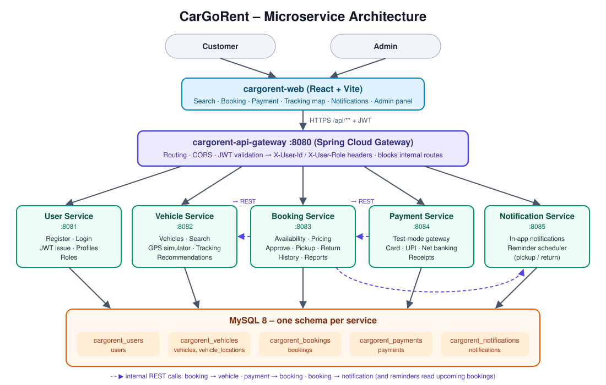

# CarGoRent – Vehicle Rental Management System

Microservice-based vehicle rental platform: customers search, book, pay for and track
rental vehicles; administrators manage the fleet, approve rentals and view reports.

**Stack:** Java 21 · Spring Boot 3.5 · Spring Cloud Gateway · MySQL 8 · Flyway · React 18 (Vite) · Leaflet/OpenStreetMap · Docker

This repo (`cargorent-infra`) holds everything needed to run the whole system:
Docker Compose files, MySQL init script, local run scripts and a Postman collection.

## Architecture



| # | Repository | Responsibility | Port | Schema |
|---|------------|----------------|------|--------|
| 1 | `cargorent-api-gateway` | Single entry point, routing, CORS, JWT validation | 8080 | – |
| 2 | `cargorent-user-service` | Register, login, JWT issuing, profiles, roles | 8081 | `cargorent_users` |
| 3 | `cargorent-vehicle-service` | Vehicle CRUD, search & filters, GPS tracking (simulated), recommendations | 8082 | `cargorent_vehicles` |
| 4 | `cargorent-booking-service` | Bookings, availability, pricing, approve/pickup/return, history, reports | 8083 | `cargorent_bookings` |
| 5 | `cargorent-payment-service` | Payments (test mode) and receipts | 8084 | `cargorent_payments` |
| 6 | `cargorent-notification-service` | In-app notifications and scheduled reminders | 8085 | `cargorent_notifications` |
| 7 | `cargorent-web` | React frontend for customers and admins | 5173 (dev) / 3000 (Docker) | – |
| 8 | `cargorent-infra` | Compose, SQL init, scripts, Postman collection | – | – |

**Key design points**

- **Database per service** – one MySQL server, one schema per service. Services never share
  tables; cross-service references are plain IDs (no cross-schema foreign keys).
- **Gateway security** – the user-service issues an HS256 JWT. The gateway validates it on every
  request, removes any `X-User-*` headers sent by the client, and forwards the verified identity
  as `X-User-Id`, `X-User-Role`, `X-User-Name`, `X-User-Email`. Internal service-to-service
  routes (e.g. `PATCH /bookings/{id}/status`) are blocked at the gateway.
- **Synchronous REST** between services (Spring `RestClient`), short timeouts, no Kafka.
  Notifications are best-effort: a notification failure never fails a booking.
- **Fixed service URLs** in the gateway config (service discovery with Eureka is future scope).

### Service-to-service calls

| From | To | Call | Why |
|------|----|------|-----|
| booking | vehicle | `GET /vehicles/{id}` | Price per day and existence check when booking |
| vehicle | booking | `GET /bookings/booked-vehicle-ids?from=&to=` | Hide booked vehicles in a date search; find vehicles on rent for the GPS simulator |
| vehicle | booking | `GET /bookings/user/{userId}` | Recommendation history; customer tracking permission |
| payment | booking | `GET /bookings/{id}` | Amount and owner check before charging |
| payment | booking | `PATCH /bookings/{id}/status` | Mark booking CONFIRMED after successful payment |
| booking | notification | `POST /notifications` | Notify customer on confirm, approve, pickup, return, cancel |
| notification | booking | `GET /bookings/upcoming` | Reminder job finds pickups/returns due soon |

### Booking life cycle

```
PENDING_PAYMENT ──pay──▶ CONFIRMED ──admin approves──▶ APPROVED ──pickup──▶ PICKED_UP ──return──▶ RETURNED
       │                     │                            │
       └──────────── cancel (customer: before approval; admin: until pickup) ──▶ CANCELLED
```
Unpaid bookings are cancelled automatically after 30 minutes so they do not block the vehicle.

## Running it

> **On Windows?** Follow the step-by-step [Windows setup guide](SETUP-WINDOWS.md) – also as a [printable PDF](docs/CarGoRent-Windows-Setup-Guide.pdf).

Clone all eight repos **side by side** in one folder:

```
cargorent/
  cargorent-infra/   cargorent-api-gateway/   cargorent-user-service/   cargorent-vehicle-service/
  cargorent-booking-service/   cargorent-payment-service/   cargorent-notification-service/   cargorent-web/
```

### Option A – everything in Docker (easiest)

Needs only Docker Desktop.

```bash
cd cargorent-infra
docker compose up --build
```

Open **http://localhost:3000**. First build takes a few minutes (Maven downloads dependencies).
Stop with `Ctrl+C`; `docker compose down -v` also wipes the database.

### Option B – run locally (for development)

Needs Java 21+, Maven 3.9+, Node 20+ and Docker (for MySQL only).

```bash
cd cargorent-infra
./scripts/start-local.sh          # MySQL in Docker + all 6 services (builds jars if missing)
cd ../cargorent-web
npm install
npm run dev                       # http://localhost:5173
```

Stop with `./scripts/stop-local.sh` (`--db` also stops MySQL, `--reset` wipes data).
Logs are in `cargorent-infra/logs/`. Use `REBUILD=1 ./scripts/start-local.sh` after code changes.

You can also run any single service from IntelliJ / VS Code (`mvn spring-boot:run`) while MySQL
runs via `docker compose -f docker-compose.mysql.yml up -d`.

### URLs

| What | URL |
|------|-----|
| Web app | http://localhost:5173 (local) / http://localhost:3000 (Docker) |
| API gateway | http://localhost:8080/api/... |
| MySQL (Workbench, DBeaver…) | `127.0.0.1:3307`, user `cargorent` / `cargorent` (or `root` / `root`) |
| Swagger UI (each service) | http://localhost:8081/swagger-ui.html … http://localhost:8085/swagger-ui.html |

When calling a service directly in Swagger, add the headers `X-User-Id` and `X-User-Role`
(e.g. `1` / `ADMIN`) to act as a logged-in user.

## Demo accounts and test data

| Role | Email | Password |
|------|-------|----------|
| Admin (seeded on first start) | `admin@cargorent.com` | `Admin@123` |
| Customer | register one from the Sign up page | – |

Change the admin login with the `ADMIN_EMAIL` / `ADMIN_PASSWORD` environment variables.
14 vehicles across Kochi, Kozhikode, Thiruvananthapuram, Thrissur and Kannur are seeded by
Flyway. Vehicle photos are representative stock images; admins can change them in **Vehicles → Edit**.

**Payments run in test mode – no real money.**

| Method | Succeeds | Declined |
|--------|----------|----------|
| Card | `4111 1111 1111 1111`, any future expiry, any CVV | `4000 0000 0000 0002` |
| UPI | any valid id, e.g. `demo@okaxis` | `failure@upi` |
| Net banking | any bank | – |

Only the last 4 card digits are stored; CVV is never stored.

## Demo script (≈ 5 minutes)

1. **Register** a customer → lands on Browse with *Recommended for you* (best value per type).
2. **Search**: pick pickup/return dates, filter by type/city/price – only free vehicles show.
3. Open a vehicle → live **quote** (long-rental discount for 7+ days) → **Book now**.
4. **Pay** with the declined card first (shows failure), then the success card → **receipt** (print/PDF).
5. Bell icon shows a *Booking confirmed* **notification**.
6. Log in as **admin** → Dashboard → **Bookings → To approve → Approve → Mark picked up**.
7. **Tracking**: the rented vehicle turns green and starts moving (simulated GPS, every 5 s).
   As the customer, **My bookings → Track live** shows the route on the map.
8. Admin → **Mark returned** → customer sees *Thanks for riding*; recommendations now
   reflect their history (same type/brand/budget/city).
9. Admin → **Reports**: revenue per day, top vehicles, revenue by type, **Export CSV**.
10. Reminders: a booking with pickup today/tomorrow gets a reminder every 15 min check;
    trigger it instantly with `POST /api/notifications/reminders/run` (Postman, admin token).

## Postman

Import `postman/CarGoRent.postman_collection.json`, then run the collection top to bottom
(Collection Runner works – tokens and IDs are saved automatically). It covers the whole flow
plus security checks (401 without token, 403 for customer on admin API, 404 on internal routes).

## Tests

```bash
cd cargorent-booking-service && mvn test   # pricing, overlap, status flow, ownership
cd cargorent-vehicle-service && mvn test   # recommendation scoring
cd cargorent-payment-service && mvn test   # test-mode gateway, Luhn check, card rules
```

## Scope notes (agreed for submission)

- Payment gateway runs in **test mode** (built-in mock that behaves like Razorpay/Stripe test mode).
- **GPS is simulated** inside the vehicle service; a real device would call `POST /api/vehicles/{id}/location`.
- **Recommendation is rule-based** (type, brand, budget and city of past rentals).
- **Reminders are in-app notifications** (email is future scope).

## Future scope

Eureka service discovery · Razorpay live integration · real GPS devices / mobile app ·
email & SMS reminders · refunds workflow · damage/late-return fees · Kafka events · Kubernetes deployment.
